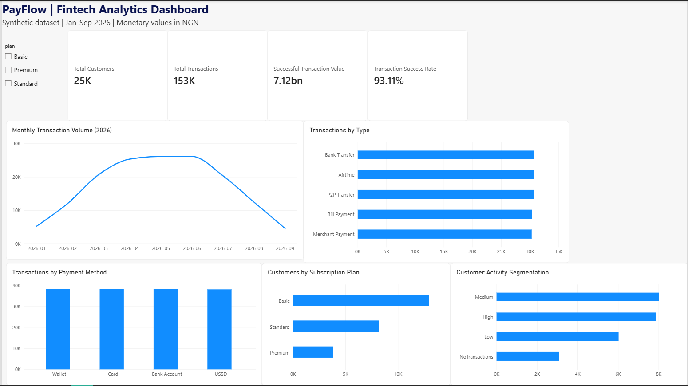

# PayFlow - Fintech Data Analytics Project

## Project Overview

PayFlow is an end-to-end fintech data analytics portfolio project focused on understanding customer behaviour, transaction performance, payment reliability, and customer engagement.

The project uses a **synthetic dataset containing 25,000 customers and 152,870 transactions** to simulate the analytical challenges faced by a digital payments business.

Using Python, MySQL, and Power BI, I explored the data, investigated business questions, and developed an interactive dashboard to communicate the findings.

## Project Objectives

The main objectives were to:

- Analyze customer demographics, engagement, and transaction activity.
- Examine payment volumes, transaction types, and payment methods.
- Identify customers who registered but never transacted.
- Investigate transaction success and failure patterns.
- Compare customer performance across subscription plans.
- Develop an interactive Power BI dashboard to communicate key performance indicators.

## Tools and Technologies

| Tool | Application |
|---|---|
| Python | Data exploration, cleaning, and analysis |
| Pandas & NumPy | Data manipulation, aggregation, and customer segmentation |
| MySQL | Relational database analysis and business queries |
| Power BI | Data modeling, DAX measures, and interactive dashboard development |
| Git & GitHub | Version control and portfolio presentation |

## Dataset Description

The project contains two principal datasets.

**Customers - 25,000 records**

Includes customer identifiers, registration dates, demographics, geographic information, customer types, acquisition channels, subscription plans, and account status.

**Transactions - 152,870 records**

Includes transaction identifiers, customer identifiers, dates, amounts, transaction types, payment methods, and transaction statuses.

The datasets are connected through `customer_id`.

**Data disclaimer:** All data used in this project is synthetic and does not represent actual customers or transactions from a real financial institution.

## Project Methodology

### 1. Python Data Analysis

Used Python, Pandas, and NumPy to inspect and analyze the datasets.

The analysis covered customer demographics, account activity, transaction values, payment status, customer segmentation, and engagement patterns.

Customers were grouped into activity segments based on transaction frequency.

### 2. SQL Business Analysis

Created a MySQL database containing the customer and transaction tables.

Completed 10 business analysis questions covering customer rankings, subscription plan performance, transaction frequency, customers without transactions, monthly performance, month-over-month growth, payment failures, and customer segments.

SQL techniques included:

- INNER JOIN and LEFT JOIN
- GROUP BY and HAVING
- Aggregate functions
- CASE WHEN expressions
- Common Table Expressions (CTEs)
- Subqueries
- Window functions, including LAG() and DENSE_RANK()

### 3. Power BI Dashboard

Developed an interactive dashboard featuring:

- Total Customers
- Total Transactions
- Successfully Processed Transaction Value
- Transaction Success Rate
- Monthly Transaction Volume
- Transactions by Type
- Transactions by Payment Method
- Customers by Subscription Plan
- Customer Activity Segmentation
- Interactive Subscription Plan filter

The dashboard uses a one-to-many relationship between customers and transactions, with DAX measures for the main KPIs.

### Dashboard Preview

## Key Findings

**1. Customer participation**

Of the 25,000 registered customers, 21,918 had transaction records, while 3,082 (12.33%) had never transacted.

**2. Transaction reliability**

Approximately 93.11% of transaction attempts were successful, while 5.16% failed and 1.74% remained pending.

**3. Monthly transaction activity**

Transaction volume increased from 5,282 in January to a peak of 26,096 in June 2026, before declining through September.

**4. Customer engagement**

Among customers who transacted:

- Low activity: 6,027 customers
- Medium activity: 8,009 customers
- High activity: 7,882 customers

Medium- and high-activity customers collectively represented approximately 72.5% of transacting customers.

**5. Subscription plan performance**

Basic customers contributed the highest total successfully processed transaction value, largely reflecting the plan's larger customer base.

Average successfully processed transaction value per participating customer was similar across Basic, Standard, and Premium plans.

**6. Payment method performance**

Wallet, Card, Bank Account, and USSD had relatively similar transaction volumes, with no single payment method overwhelmingly dominating activity.

## Business Recommendations

Based on the simulated results, PayFlow could consider:

- Investigating onboarding and activation challenges among customers who registered but never transacted.
- Monitoring payment success rates and investigating combinations with relatively higher observed failure rates.
- Exploring retention opportunities for highly engaged customers.
- Investigating the observed decline in transaction volume after June.
- Evaluating customer engagement across subscription plans instead of relying solely on total transaction volume.

These recommendations are exploratory. The synthetic dataset does not establish causal relationships or validate the effectiveness of particular interventions.

## Project Limitations

- The datasets are synthetic, so findings should not be interpreted as actual business performance.
- The available transaction values do not directly represent PayFlow's revenue or profit.
- Differences between reporting periods may be affected by dataset coverage.
- Additional operational information would be necessary to determine why certain transactions fail or why customers remain inactive.

## Project Files

- `Python/` — Python analysis and data preparation scripts.
- `SQL/` — MySQL database setup and business analysis queries.
- `Powerbi/` — Interactive Power BI dashboard file.
- `data/` — Original synthetic customer and transaction datasets.
- `README.md` — Project documentation.

## Conclusion

This project demonstrates my ability to work through an end-to-end data analytics workflow, from data preparation and exploration to SQL analysis, business interpretation, and interactive reporting.

It also strengthened my practical skills in Python, SQL, Power BI, and communicating analytical findings.

The project forms part of my ongoing development in data analytics and my broader journey toward quantitative finance.